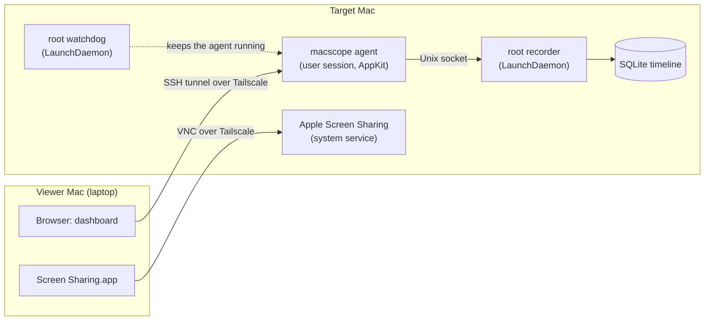

# tidemark

[](https://github.com/rene404/tidemark/actions/workflows/ci.yml)
[](LICENSE)

Self-hosted TeamViewer replacement for remote access between Macs: an
activity timeline, safe remote actions and live screen access over
[Tailscale](https://tailscale.com). No cloud service, no third-party relay.
Everything stays on the target Mac and is reached through an encrypted tunnel.

> **Status: 0.2 in preparation.** Unit, HTTP and browser tests run in CI, but
> the native macOS parts (AppKit events, LaunchAgents, managed mode) have **not
> yet been accepted on real hardware**. See [Roadmap](#roadmap).

The Python package is called `macscope` (the original prototype name); the
project and repository are called `tidemark`. The dashboard UI and the detailed
docs in [`docs/`](docs) are in German.

## How it works



- An **agent** runs in the logged-in user session on the target Mac. It records
  app launches, quits, activations, sleep and wake into a local SQLite
  database and serves a dashboard on `127.0.0.1` only.
- The **viewer** opens that dashboard through an SSH tunnel over Tailscale.
  Access additionally requires a secret access token.
- **Live screen (phase A):** the dashboard opens Apple's built-in Screen
  Sharing (`vnc://<tailscale-name>`). An own Swift module may replace it later
  behind the same interface ([docs/VIEWER-NAHT.md](docs/VIEWER-NAHT.md)).
- **Managed mode:** the watched account is a standard user. The program files
  belong to root, a root watchdog restarts the agent, and a root recorder service
  owns the timeline, so the user can neither switch it off nor delete the
  history; only an administrator can ([docs/VERWALTETER-MODUS.md](docs/VERWALTETER-MODUS.md)).

## Features

| Area | What it does |
|---|---|
| Timeline | GUI app launched / quit / activated, sleep / wake, session changes; apps already running at agent start are marked as such, not as new launches |
| Running apps | Name, bundle ID, PID and launch time, refreshed every second |
| Remote quit | Normal quit request for allow-listed apps (Firefox by default). "Request sent" and "app actually quit" are separate, logged states |
| Live screen | Opens Apple Screen Sharing over Tailscale; every request and every actual connection (peer, duration) is logged in the timeline |
| Search | By app / bundle ID and event type, paging into older entries |
| Retention | 30 days by default, pruned at start and hourly |
| Managed mode | No pause / quit in the menu bar, settings only from a root-owned file, automatic restart, root watchdog that also detects a hung or stopped agent, timeline stored by a root service (append-only for the user) |
| Access | Loopback only, access token, host and origin checks, strict CSP |

**Not collected:** browser URLs, window titles, file contents or changes,
network connections, background processes, screenshots. The AppKit collector
is **not** a complete process audit and only sees the logged-in GUI session.

## Requirements

- macOS 12 or later on the target Mac (Intel or Apple Silicon); macOS 14+ for
  the Swift test tool
- Python 3.11–3.14, recommended: 3.13 from [python.org](https://www.python.org/downloads/macos/)
- Tailscale on both Macs, Remote Login (SSH) enabled on the target Mac
- Xcode Command Line Tools for `git` (or download the ZIP from GitHub)

## Installation

```bash
git clone https://github.com/rene404/tidemark.git
cd tidemark
```

### Recommended: managed mode

Run from an **administrator** account on the target Mac. `USER` is the
**standard** account to be watched; `TARGET-MAC` is its Tailscale name.

```bash
sudo bash install-managed.command install --user USER --viewer-host TARGET-MAC
```

Options: `--allow-app BUNDLE-ID` (repeatable; default: Firefox only),
`--retention-days N`, `--erlaube-admin` (allow an admin target, for tests only).
The installer refuses admin accounts as targets, puts the program under
`/Library/Application Support/MacScope` (owned by root), installs a system-wide
LaunchAgent and the watchdog LaunchDaemon, and starts the agent if the user is
logged in.

Show the access token (as admin):

```bash
sudo "/Library/Application Support/MacScope/venv/bin/macscope" token
```

Check the status:

```bash
"/Library/Application Support/MacScope/venv/bin/macscope" diagnose   # "mode": "verwaltet für USER"
```

### Alternative: single user, unmanaged

For testing in your own account. No sudo; the user can pause or quit it.

```bash
bash install.command                  # installs to ~/Applications/MacScope
bash ~/Applications/MacScope/start.command
~/Applications/MacScope/.venv/bin/macscope token     # in a second terminal
```

Autostart at login: `bash install.command --autostart`, or later
`~/Applications/MacScope/.venv/bin/python ~/Applications/MacScope/scripts/autostart.py install`.

## Connecting from the viewer Mac

1. Install Tailscale on both Macs and sign in to the same tailnet
   (`tailscale status` lists the other device).
2. On the target Mac: System Settings → General → Sharing → enable
   **Remote Login** for the account you connect with; use an SSH key.
3. Open the tunnel on the viewer and keep the terminal open:

   ```bash
   ssh -N -o ExitOnForwardFailure=yes -o ServerAliveInterval=30 \
     -L 127.0.0.1:8765:127.0.0.1:8765 ACCOUNT@TARGET-MAC
   ```

4. Open `http://127.0.0.1:8765/` and enter the access token. The token stays in
   the tab's memory only (no URL, cookie or local storage); reloading asks again.

If port 8765 is taken locally, use e.g. `-L 127.0.0.1:8766:127.0.0.1:8765` and
open port 8766. Verify the SSH host key on first connect; never disable host
key checking. The tunnel uses the regular macOS SSH service, not Tailscale SSH.

**Live screen:** enable System Settings → General → Sharing → **Screen
Sharing** on the target Mac (admin). The dashboard then shows "Bereit" and a
button that opens Apple's Screen Sharing app; choose observe or control there.
Screen Sharing also works before anyone logs in, the dashboard does not.

## Remote quit

The dashboard sends a normal quit request (`NSRunningApplication.terminate()`),
never a force quit. Right before the request, the agent re-checks PID, bundle
ID and launch time on the main thread, so a reused PID cannot hit the wrong
app. Queued requests expire after 10 seconds (also across sleep) and are never
replayed after a restart. The result is confirmed for up to 15 seconds; if a
save or "close tabs?" dialog keeps the app open, it is reported as
"App-Ende nicht bestätigt" instead of a success.

## Configuration (unmanaged mode)

```bash
~/Applications/MacScope/.venv/bin/macscope run \
  --retention-days 14 --allow-app com.apple.TextEdit --viewer-host TARGET-MAC
```

`--port` changes the local port (the tunnel target must match); the bind
address is always `127.0.0.1`. In managed mode these options are ignored and
the values come from `/Library/Application Support/MacScope/managed.json`.

## Data and security

```text
~/Library/Application Support/MacScope/      (per user, mode 0700)
  access-token        access token, mode 0600 (unmanaged mode)
  timeline.sqlite3    events and action log (unmanaged mode)
  agent.lock          prevents two agents on the same data directory
  logs/               agent log (rotated at 1 MB, 3 generations)
  heartbeat           liveness file for the root watchdog (managed mode)

/Library/Application Support/MacScope-Data/  (managed mode, root only, 0700)
  access-token, timeline.sqlite3   owned by the root recorder service
```

- The database is **not encrypted at application level**. Enable FileVault on
  both Macs. The HTTP connection never leaves the machine; SSH protects the
  transport between the Macs. The viewer keeps no copy of the database.
- Expired events are deleted logically; old database pages are not securely wiped.
- In managed mode the watched user cannot read, change or delete the stored
  timeline. The agent can only append events and read them back through the
  recorder's socket, so the user can still add entries and obtain the token.
  This is not tamper-proof forensic logging; see the limits in
  [docs/VERWALTETER-MODUS.md](docs/VERWALTETER-MODUS.md).

## Demo without a real session

Runs on any OS, never touches real apps, uses a separate data directory:

```bash
python3 -m macscope run --demo
python3 -m macscope token --demo        # second terminal
```

## Uninstall

Managed mode (keeps the timeline in `/Library/Application Support/MacScope-Data`;
add `--daten-loeschen` to delete it too):

```bash
sudo bash install-managed.command remove
```

Unmanaged mode:

```bash
~/Applications/MacScope/.venv/bin/python ~/Applications/MacScope/scripts/autostart.py remove
```

Then quit the agent from the menu bar and delete `~/Applications/MacScope`.
Delete `~/Library/Application Support/MacScope` to remove the recorded data.
Tailscale and SSH settings are not changed by either uninstall.

## Development

```bash
python3 -m unittest discover -s tests -v     # unit + HTTP tests
python3 tests/browser_smoke.py               # needs playwright + chromium
```

CI (GitHub Actions) runs the tests on macOS with Python 3.11 and 3.13, installs
the package with PyObjC, builds the Swift test tool and runs the browser test.
Workflow: gitflow. Branch from `develop`, open pull requests against `develop`,
releases go to `main`.

| Path | Purpose |
|---|---|
| `macscope/` | Agent: AppKit collector, service, store, HTTP server, viewer seam, managed mode, watchdog, root recorder |
| `macscope/web/` | Dashboard (static HTML/CSS/JS, no external resources) |
| `scripts/` | Installers and LaunchAgent helpers |
| `tools/capture-probe/` | Swift test tool for phase-B risks (screen-recording permission behaviour) |
| `docs/` | Architecture, managed mode, viewer seam, code signing, test protocols (German) |

## Roadmap

| Phase | Content | State |
|---|---|---|
| 0 · Foundation | Tailscale, standard account, managed mode, root watchdog | built, hardware acceptance pending |
| A · Live screen via Apple | Viewer seam, Apple Screen Sharing over Tailscale | built, hardware acceptance pending. After this, TeamViewer can go |
| B1 · Own screen stream | Swift module (ScreenCaptureKit) behind the same seam, view only | stream relay and in-dashboard viewer built and tested with a demo source (`--demo`); Swift source open: depends on the [CaptureProbe](tools/capture-probe/README.md) results and [code signing](docs/CODE-SIGNATUR.md) |
| B2 · Own remote control | Mouse / keyboard via CGEvent | open |
| B3 · Polish | H.264, latency; decide whether Apple Screen Sharing can be switched off | open |

Known risk for phase B: since macOS 15, apps that record the screen trigger a
roughly monthly re-approval prompt that cannot be avoided without MDM. Apple's
own Screen Sharing is not affected. Details in [docs/CODE-SIGNATUR.md](docs/CODE-SIGNATUR.md).

## References

- [Apple: NSWorkspace launch notifications](https://developer.apple.com/documentation/appkit/nsworkspace/didlaunchapplicationnotification)
- [Apple: NSRunningApplication.terminate()](https://developer.apple.com/documentation/appkit/nsrunningapplication/terminate())
- [Apple: Allow a remote computer to access your Mac](https://support.apple.com/guide/mac-help/allow-a-remote-computer-to-access-your-mac-mchlp1066/mac)
- [PyObjC: installation](https://pyobjc.readthedocs.io/en/latest/install.html) and [supported platforms](https://pyobjc.readthedocs.io/en/latest/supported-platforms.html)

`pyproject.toml` allows PyObjC `>=11.1,<13`; the installers and CI install the
tested versions from [`constraints.txt`](constraints.txt) (`pyobjc-core` and
`pyobjc-framework-Cocoa` 12.2.2, universal2 wheels for Intel and Apple Silicon).
PyObjC packages must always share one version.

## License

[MIT](LICENSE)
