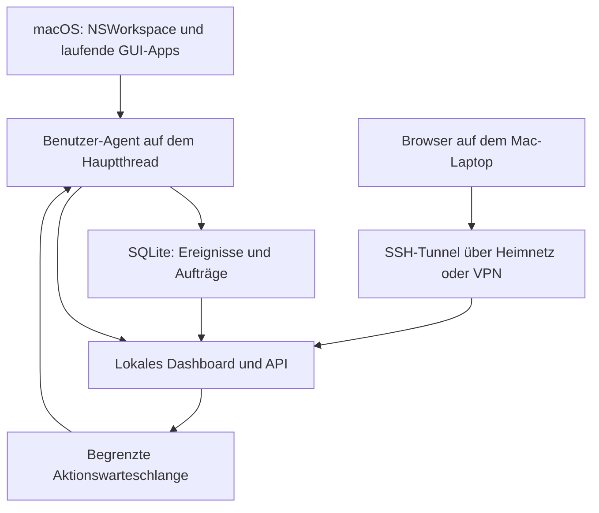
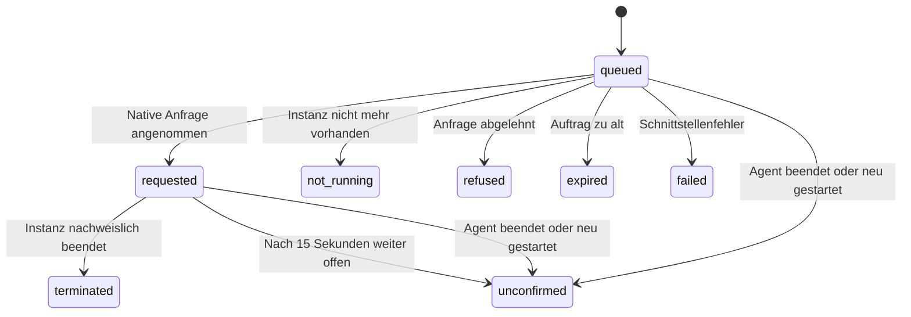

# MacScope — Aufbau und Entwicklung

## Datenfluss

Python übernimmt Speicherung, Zugriffsprüfung und HTTP. PyObjC verwendet Apples
AppKit für Ereignisse und die Bedienung laufender Apps. Es gibt keinen
Cloud-Server und kein frei erreichbares Verwaltungsportal. Das Dashboard
besteht aus statischem HTML, CSS und JavaScript ohne extern geladene Schriften,
Bibliotheken oder Dienste.

## Verantwortung der Komponenten

| Datei | Aufgabe |
| --- | --- |
| `macscope/platform_macos.py` | NSWorkspace-Ereignisse, Menüleiste, Snapshot und normale Beenden-Anfrage |
| `macscope/service.py` | Zustand, Begrenzung der Aufträge, Freigabeliste, Bestätigung und Ablauf |
| `macscope/store.py` | SQLite, Cursor, Aufbewahrung und persistentes Aktionsprotokoll |
| `macscope/server.py` | Nur Loopback; Schlüssel-, Host- und Origin-Prüfung |
| `macscope/web/` | Anmeldung, Zeitleiste, Suchfilter, App-Liste, Beenden-Dialog |
| `macscope/demo.py` | Ausdrückliche Simulation, keine echte OS-Aktion |
| `scripts/autostart.py` | Optionaler LaunchAgent im eigenen Benutzerkonto |

Native AppKit-Aufrufe erfolgen auf dem Hauptthread. HTTP-Anfragen stellen
Aufträge in eine begrenzte Warteschlange mit maximal 32 Einträgen; sie rufen
keine AppKit-Aktion aus einem HTTP-Thread auf. Ein einmal pro Sekunde laufender
Timer aktualisiert den Zustand und verarbeitet Aufträge. Jeder DB-Zugriff
bekommt eine eigene, anschließend geschlossene Verbindung; WAL erlaubt
gleichzeitiges Lesen während eines Schreibvorgangs.

## Ereignisse

Ein Ereignis hat eine monoton wachsende ID, eine UTC-Unix-Zeit, einen Typ,
optionale App-Identität und ein JSON-Detailfeld. Die Zeitdarstellung passiert
im Browser in der lokalen Zeitzone. Filter sind SQL-Parameter; Cursor basieren
auf der ID. Beim Start beobachtete Apps werden ausdrücklich nicht als neu
gestartet ausgegeben. Anwendungsereignisse werden während einer sichtbaren
Pause verworfen; Aktionsaufträge bleiben weiterhin protokolliert.

Ein Zwischenstand im Dashboard wird jede drei Sekunden abgefragt. Die
Standardansicht hält höchstens die jüngsten 500 Ereignisse im DOM. Beim Laden
älterer Einträge pausiert die Live-Nachführung der Zeitleiste; App-Zustand und
Aktionsstatus werden weiter aktualisiert. Die historische Ansicht hält maximal
2.000 Einträge und kann mit „Aktualisieren“ zur Liveansicht zurückkehren.

## Fernaktion und Ergebnis

`terminate()` ist nur eine bestätigte Übermittlung der Anfrage. Ein späterer
Snapshot entscheidet über das tatsächliche Ende. Die App-Instanz wird durch
PID, Bundle-ID und Startzeit identifiziert. Vor der Aktion wird die Identität
noch einmal am lebenden AppKit-Objekt geprüft. Es werden keine vom Netzwerk
übermittelten Shell-Befehle oder AppleScript-Fragmente ausgeführt.

## Abgrenzung und Grenzen

- Ein lokaler Benutzer mit Zugriff auf das eigene Benutzerkonto kann auch auf
  dessen Protokolle und Schlüssel zugreifen. Dieses System ist keine
  manipulationssichere forensische Beweissicherung.
- Während der iMac schläft oder ausgeschaltet ist, wird keine Liveverbindung
  angeboten. Nach einem Neustart läuft der Benutzer-Agent erst nach der
  Anmeldung. FileVault und VPN-Start können zusätzlich die Erreichbarkeit
  beeinflussen; beides muss am Zielgerät geprüft werden.
- Der Prototyp nutzt Pythons einfachen HTTP-Server mit kurzen Socket-Timeouts.
  Er ist ausschließlich für Loopback plus SSH gedacht. Für eine externe
  Bereitstellung müsste der Server neu bewertet und ersetzt werden.
- AppKit-Meldungen sind auf die grafische Benutzersitzung begrenzt. Für echte
  Prozessvollständigkeit wären EndpointSecurity-Ereignisse bzw. ein etablierter
  Collector zu integrieren; Polling genügt dafür nicht.

## Nächste Schritte

1. iMac-Version feststellen und native Abnahme durchführen.
2. Tatsächlich auf dem Mac verwendete Abhängigkeiten fixieren.
3. Bei Bedarf signierte `.app` mit eingebettetem Python erstellen; auf beiden
   Prozessorarchitekturen testen und anschließend notarisierten Installer bauen.
4. Eigene Firefox-Erweiterung für aktive URLs und Tab-Ereignisse entwickeln.
5. Konfigurierbare Datei- und System-Collector ergänzen, jeweils mit sichtbarem
   Erfassungsumfang und eigener Lastmessung.
6. Ereignisse bei Bedarf auf den Laptop replizieren; Wiederaufnahme über
   Ereignis-ID statt vollständiger Datenbankkopien implementieren.

Für den ersten einzelnen iMac sind FastAPI, eine SPA-Buildkette, Postgres oder
ein zentraler Message Broker nicht erforderlich. Bei mehreren Geräten oder
einem umfangreicheren Aktionsmodell lässt sich die HTTP-Schicht getrennt
weiterentwickeln.
