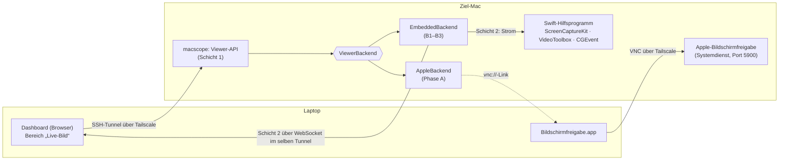

# Konzept: Viewer-Naht

Status: **Schicht 1 für Phase A umgesetzt** (`macscope/viewer.py`) · Schicht 2 spezifiziert, Code ab B1

**Entschieden (2026-11-27):** Der Betrachter in Phase B läuft **im Browser-Dashboard**, nicht als eigene Swift-App.

## Ziel

Live-Bild und Fernsteuerung so einbauen, dass beim Wechsel von Apples
Bildschirmfreigabe (Phase A) zum eigenen Modul (Phase B) **nur die Quelle
getauscht** wird. Dashboard, Anmeldung, Zugriffsprüfung, Protokollierung und
Tunnel bleiben dabei gleich.

## Die wichtigste Präzisierung

Bisher hieß es, die Naht sei „Bild holen / Eingabe senden“. In Phase A läuft
aber **weder Bild noch Eingabe durch unseren Code**. Apples Bildschirmfreigabe
bringt Server (Ziel-Mac) und Client (Bildschirmfreigabe-App auf dem Laptop)
selbst mit. Wollte man Apples Bild in Phase A durch tidemark leiten, bräuchte
man einen eigenen VNC-Client mit Apples Anmeldeverfahren in Python. Das ist viel
Arbeit und Risiko, bringt aber keinen Nutzen, denn er würde in B ohnehin
wieder ersetzt.

Deshalb hat die Naht **zwei Schichten**:

| Schicht | Was | Ab wann gebaut | Ab wann benutzt |
|---|---|---|---|
| **1 · Sitzung** | „Live ansehen“ anfragen, Fähigkeiten abfragen, Sitzung öffnen/beenden, protokollieren | Phase A | Phase A (Apple) und B (eigen) |
| **2 · Strom** | Bild holen, Eingabe senden: Nachrichtenprotokoll zwischen Quelle und Betrachter | Spezifikation in A, Code ab B1 | B1–B3 |

Schicht 1 ist die eigentliche Tausch-Stelle. Schicht 2 wird in A **nur
festgelegt** (dieses Dokument) und ab B1 gegen eine Demo-Quelle gebaut, bevor
die erste Zeile Swift entsteht.



## Schicht 1 · Sitzungs-API

### Python-Schnittstelle

```python
class ViewerBackend(Protocol):
    name: str                       # "apple" | "embedded" | "demo"

    def capabilities(self) -> dict:
        """{"kind": "external"|"embedded", "view": bool, "control": bool,
            "pre_login": bool, "available": bool, "reason": str|None}"""

    def open_session(self, mode: str) -> dict:
        """mode = "view" | "control". Liefert einen Sitzungs-Deskriptor:
           external: {"session": id, "kind": "external", "url": "vnc://…"}
           embedded: {"session": id, "kind": "embedded", "stream": "/api/viewer/stream?session=…"}"""

    def close_session(self, session: str) -> None: ...
```

In Phase A gibt es nur `AppleBackend` (echt) und `DemoBackend` (`--demo`). Die
Auswahl per Konfiguration (`"viewer": …`) kommt mit B1, sobald es eine zweite
echte Quelle gibt. Das Dashboard fragt nie nach dem Backend-Namen, sondern nur
nach `kind` und den Fähigkeiten.

### HTTP-Endpunkte (gleiche Absicherung wie heute: Loopback, Schlüssel, Host/Origin)

| Methode | Pfad | Antwort |
|---|---|---|
| `GET` | `/api/viewer` | Fähigkeiten + laufende Sitzung |
| `POST` | `/api/viewer/session` | `{"mode": "view"\|"control"}` → Deskriptor (`201`) |
| `DELETE` | `/api/viewer/session` | Sitzung beenden (`204`), ab B1 |
| `GET` (WebSocket) | `/api/viewer/stream` | nur `embedded`, ab B1 (Schicht 2) |

### Protokoll in der Zeitleiste

Ereignistypen: `viewer.requested` und `viewer.refused` (Anfrage im Dashboard, mit
Modus `view`/`control`), `viewer.opened` und `viewer.closed` (tatsächliche
Verbindung, mit Gegenstelle und Dauer), jeweils mit Backend.
Sie werden **auch während einer Pause** protokolliert. Damit ist
im Verlauf nachvollziehbar, **wann jemand zugesehen oder gesteuert hat**.

### Phase A: AppleBackend

- `capabilities`: `kind = external`, `modes_enforced = false` (Ansehen/Steuern wählt man
  in Apples App, tidemark kann das nicht erzwingen), `pre_login = true`.
  `available` prüft, ob die Bildschirmfreigabe läuft (TCP-Verbindung auf
  `127.0.0.1:5900` möglich, Ergebnis 30 s zwischengespeichert). Wenn nicht, gibt es
  einen Hinweis im Dashboard: „Bildschirmfreigabe ist aus“.
- `open_session` liefert `vnc://<Tailscale-Name>`. Der Name steht in
  `managed.json` (`"viewer_host"`, Installer: `--viewer-host`) bzw. kommt im
  unverwalteten Modus aus `--viewer-host`. Erlaubt sind nur Hostname oder IP.
  Das Dashboard öffnet ihn, und macOS startet die Bildschirmfreigabe-App.
- **Tatsächliche Verbindungen** (#21): Der Agent liest alle 5 s
  `netstat -an -p tcp` (läuft ohne Adminrechte, ca. 6 ms) und sucht aufgebaute
  Verbindungen **zum** lokalen Port 5900. Eine Gegenstelle gilt erst als verbunden,
  wenn sie bei zwei Abfragen hintereinander auftaucht. Das filtert die eigene
  Port-Prüfung und kurze Versuche heraus. Mehrere Verbindungen derselben
  Gegenstelle zählen als eine Sitzung. Die Zeitleiste zeigt „Live-Bild verbunden
  (100.x.y.z)“ und „Live-Bild getrennt (…, Dauer)“, das Dashboard „Gerade
  verbunden: …“.
- Grenzen der Erkennung: Sie läuft nur, solange der Agent läuft, also nicht vor
  der Anmeldung. Nach einem Agent-Neustart erscheint eine laufende Sitzung erneut
  als „verbunden“. Ansehen und Steuern sind nicht unterscheidbar. Den
  **Hochleistungsmodus** von macOS 14+ (nur Apple Silicon auf beiden Seiten) über
  UDP sieht die Erkennung vermutlich nicht; das prüft die Abnahme.

### Dashboard (Phase A)

Ein neuer Bereich **„Live-Bild“** mit Status (Bereit / Nicht verfügbar + Grund).
Bei `modes_enforced = false` (Apple) gibt es **einen** Knopf „Bildschirmfreigabe
öffnen“, bei erzwingbaren Modi (ab B1) „Ansehen“ und „Steuern“. Bei `external`
öffnet das Dashboard den Link, bei `embedded` (ab B1) den eingebetteten
Betrachter auf derselben Seite. Der Rest der Oberfläche merkt keinen Unterschied.

## Schicht 2 · Strom-Protokoll (Spezifikation, Code ab B1)

**Transport:** WebSocket (binär) unter `/api/viewer/stream`, durch denselben
SSH-Tunnel und Schlüssel wie das Dashboard. Python **leitet nur weiter** und
prüft dabei: Sitzung gültig, Modus erlaubt (keine Eingaben bei `view`),
Nachrichtengröße und Rate begrenzt. Zwischen Python und Swift-Hilfsprogramm
laufen dieselben Nachrichten über stdin/stdout (Länge + Nachricht). Swift ist
Kindprozess des Agenten und hat kein eigenes Netzwerk.

**Nachrichten:** 1 Byte Typ + Nutzlast. Steuernachrichten JSON, Bilddaten roh.

| Richtung | Typ | Inhalt |
|---|---|---|
| Quelle → Betrachter | `HELLO` | Protokollversion, Bildschirmgröße in Punkten, Skalierung, unterstützte Codecs |
| | `FRAME` | Codec, Schlüsselbild ja/nein, Zeitstempel, Daten (B1: JPEG ganzes Bild/Rechtecke; B3: H.264) |
| | `CURSOR` | Position (normiert 0–1), optional Form |
| | `DISPLAY` | Auflösung/Bildschirm hat sich geändert |
| | `BYE` | Grund (beendet, Sperrbildschirm, keine Berechtigung, Fehler) |
| Betrachter → Quelle | `START` | Codec-Wunsch, max. Bildrate, Qualität |
| | `POINTER` | Position normiert 0–1, Tastenzustand |
| | `WHEEL` | Δx, Δy |
| | `KEY` | `KeyboardEvent.code`, gedrückt/losgelassen, Modifikatoren |
| | `KEYFRAME` | Schlüsselbild anfordern (nach Paketverlust/Fensterwechsel) |
| | `STOP` | Sitzung beenden |

Koordinaten sind **normiert (0–1)**. Damit sind Retina-Faktor und Fenstergröße
des Laptops egal. Tasten werden als physische Codes übertragen, nicht als Text.
Das vermeidet Probleme mit dem Tastaturlayout (deutsches Layout auf beiden Seiten).

**Ausbaustufen:**

- **B1 (nur ansehen):** JPEG-Bilder mit begrenzter Bildrate, keine Eingaben.
  Python-Weiterleitung, Browser-Betrachter und eine **Demo-Quelle in Python**
  entstehen zuerst und sind ohne Mac testbar. Danach kommt die Swift-Quelle dazu.
- **B2 (steuern):** `POINTER`/`WHEEL`/`KEY` → CGEvent im Swift-Programm.
- **B3 (Feinschliff):** H.264 über VideoToolbox, Dekodieren im Browser per
  WebCodecs, Rechteck-Updates, Latenzmessung. Danach Entscheidung „Apple aus“.

## Anforderungen, die über Technik hinausgehen

- **Sichtbarkeit am Ziel-Mac:** Solange jemand zusieht oder steuert, zeigt die
  Menüleiste das deutlich an (z. B. „◉ MS · wird angesehen“). Apple macht das in
  Phase A bereits selbst. Für das eigene Modul ist es Pflicht, nicht optional.
- **Jede Sitzung wird protokolliert** (siehe Ereignistypen oben).
- **Steuern ist eine eigene Freigabe**, getrennt vom Ansehen, und lässt sich ab B2 im
  verwalteten Modus abschalten (`"viewer_control": false`). Bei Apple ist das
  nicht durchsetzbar und deshalb in Phase A nicht vorgesehen.

## Risiken für Phase B (früh prüfen)

| Risiko | Warum es zählt | Gegenmaßnahme / Prüfung |
|---|---|---|
| **Berechtigungen** (Bildschirmaufnahme, Bedienungshilfen) | Ohne sie kein Bild bzw. keine Steuerung. Ein Standardbenutzer kann sie nicht ohne Admin-Passwort erteilen | Einmalig als Admin am Gerät freigeben; im Abnahmeprotokoll festhalten |
| **Code-Signatur des Swift-Programms** | macOS bindet Berechtigungen an die Signatur. Unsigniert/ad hoc gehen sie bei jedem Neubau verloren | Vor B1 entscheiden: Apple-Entwicklerkonto (Developer ID) oder stabiles selbst erstelltes Zertifikat |
| **Wiederkehrende Bildschirmaufnahme-Rückfragen** (neuere macOS-Versionen) | Der Benutzer müsste regelmäßig etwas bestätigen, was er nicht soll | Auf dem Test-Mac mit der tatsächlichen macOS-Version prüfen, bevor B1 gebaut wird; ohne MDM evtl. nicht abschaltbar |
| **Vor der Anmeldung / Sperrbildschirm** | Das eigene Modul läuft in der Benutzersitzung und sieht das Anmeldefenster nicht | Apple bleibt für „vor der Anmeldung“ als Rückfall. „Apple abschalten“ erst, wenn das gelöst oder bewusst akzeptiert ist |
| **WebSocket im Python-Server** | Der heutige Server (Standardbibliothek) kann kein WebSocket | B1: kleine eigene Umsetzung (nur Server, binär, ohne Erweiterungen) mit Tests, oder bewusst eine Abhängigkeit |
| **CSP des Dashboards** | Erlaubt heute nur `'self'`, kein WebSocket, keine `blob:`-Bilder | Ab B1 gezielt `connect-src 'self'` und `img-src blob:` ergänzen |

## Umsetzungsplan

**Phase A:**

1. ✅ `macscope/viewer.py`: `AppleBackend`, `DemoBackend`, `NoBackend`
2. ✅ Service + Server: `GET /api/viewer`, `POST /api/viewer/session`, Ereignistypen, Tests
3. ✅ `managed.json`/Installer/Startoption: `viewer_host` (mit Prüfung)
4. ✅ Dashboard: Bereich „Live-Bild“
5. ⬜ Abnahme auf dem Test-Mac (unten) → **danach ist TeamViewer ersetzbar**

### Abnahme Phase A auf dem Test-Mac

| ✓ | Schritt | Erwartung |
|---|---|---|
| [ ] | Agent mit `--viewer-host <Tailscale-Name>` (bzw. Installer `--viewer-host`), Bildschirmfreigabe **aus** | Dashboard: „Nicht verfügbar“ + Hinweis „Bildschirmfreigabe ist aus“ |
| [ ] | Als Admin: Systemeinstellungen → Allgemein → Freigaben → Bildschirmfreigabe an | Nach ≤ 30 s „Bereit“ |
| [ ] | Prüfen, ob der Port-Test (Verbindung auf 5900) am Ziel-Mac sichtbare Spuren hinterlässt (Meldung, Protokoll) | Keine Meldung für den Benutzer |
| [ ] | Laptop: „Bildschirmfreigabe öffnen“ | Bildschirmfreigabe-App startet mit `vnc://<Tailscale-Name>`, Anmeldung klappt; Zeitleiste: „Live-Bild angefragt“ |
| [ ] | Verbindung steht ≥ 10 s, dann Apples App schließen | Zeitleiste: „Live-Bild verbunden (Tailscale-IP des Laptops)“, Dashboard „Gerade verbunden: …“; nach dem Schließen „Live-Bild getrennt“ mit Dauer |
| [ ] | In Apples App „Beobachten“ und „Steuern“ umschalten | Beides funktioniert; am Ziel-Mac zeigt die Menüleiste, dass der Bildschirm geteilt wird |
| [ ] | Laptop außerhalb des Heimnetzes (Hotspot) | Wie oben |
| [ ] | Ziel-Mac neu starten, **nicht** anmelden, vom Laptop `vnc://<Tailscale-Name>` direkt öffnen | Anmeldefenster sichtbar und bedienbar (Dashboard ist vor der Anmeldung nicht erreichbar) |
| [ ] | Als Standardbenutzer am Ziel-Mac: Bildschirmfreigabe abschalten versuchen | Verlangt Admin-Passwort |

**B1 (später):** WebSocket-Weiterleitung + Browser-Betrachter + Demo-Quelle →
Swift-Quelle (nur ansehen) → `EmbeddedBackend`.

## Offene Entscheidungen

1. **Betrachter in Phase B:** im Browser/Dashboard (empfohlen: eine Oberfläche,
   kein zweites Programm, funktioniert von jedem Rechner) **oder** eigene
   Swift-App auf dem Laptop.
2. **Sichtbarer Hinweis beim Betrachten** am Ziel-Mac. Empfohlen: immer an, nicht abschaltbar.
3. **Code-Signatur** für das Swift-Programm (erst vor B1 nötig).
